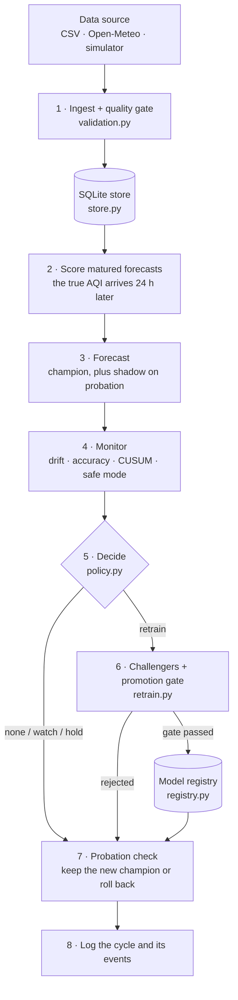
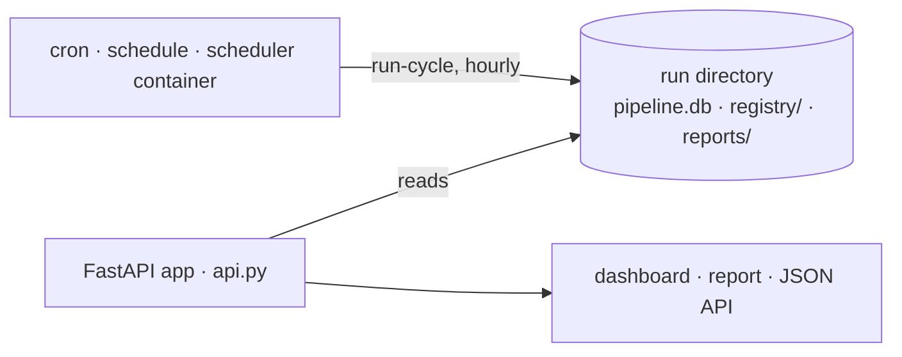

# Architecture

## In one paragraph

`aqi-pipeline` forecasts India's CPCB Air Quality Index (AQI) 24 hours ahead for one monitoring
station, from hourly pollutant and weather readings. Around the forecaster it runs everything a
model needs in production: a data quality gate, input drift and accuracy monitoring, a policy
that decides when (and when not) to retrain, challengers trained on several data strategies, a
statistical promotion gate, a probation period with automatic rollback, a fallback to the
persistence forecast, and an audit trail of every decision. It is one Python package
(`src/aqi_pipeline/`) with a CLI, a FastAPI service, a live dashboard and a self-contained HTML
report. All state lives in one SQLite file and a file-based model registry.

## The cycle

`Pipeline.run_cycle(now)` in `pipeline.py` is the heart of the system. It is meant to be called
every hour (cron, `aqi-pipeline schedule`, or the compose `scheduler` container); the
simulation calls it once per simulated day.



| Step | Method | What happens |
| --- | --- | --- |
| 1 | `ingest` | Fetch rows newer than the last stored hour, run the quality gate, upsert them; log a `data_quality` event if the batch did not pass |
| 2 | `score_matured` | Attach the true AQI to forecasts whose target hour has passed |
| 3 | `predict` | Forecast every new hour with the champion (and the shadow during probation); serve persistence instead while safe mode is on |
| 4 | `monitor` | Drift against the champion's training data, accuracy over 7 days, CUSUM, safe mode, streaks, share of bad sensor data |
| 5 | `decide` (`policy.py`) | `none`, `watch`, `hold` or `retrain`, with the reason |
| 6 | `retrain` | Challengers × data strategies and the promotion gate; promote, or keep the champion |
| 7 | `probation` | After 7 days, confirm the new champion or roll back to the shadow |
| 8 | `log_cycle` | Store the full cycle record; events were logged along the way |

**Idempotent and resumable.** Running the cycle twice for the same hour changes nothing: rows
are written by primary key, monitoring state (streaks, CUSUM, safe mode) only advances when
there is new data or a new hour, and a second retrain cannot start inside the cooldown. Because
all state is in the store and the registry, a stopped pipeline resumes where it left off.

## Key design decisions

1. **Sensor faults are not drift.** Forecasts made from flagged inputs, or scored against
   flagged labels, are excluded from monitoring and training; while recent PM data is unreliable
   the decision is `hold`. See [MONITORING.md](MONITORING.md).
2. **Drift respects seasons.** Recent inputs are compared with training data from the same time
   of year, against thresholds calibrated on the training history, weighted by how much the
   model relies on each input.
3. **Accuracy is judged against persistence** ("tomorrow = today"), so a hard week for every
   method does not look like model decay.
4. **Retraining is gated.** Challengers trained on three data strategies must beat the champion
   by 5 % with 95 % bootstrap probability on the latest days, then survive a 7-day probation or
   be rolled back automatically. See [RETRAINING.md](RETRAINING.md).
5. **Safe mode.** While the model does worse than persistence, persistence is served.

## Module map

| Area | Module | Key names | Responsibility |
| --- | --- | --- | --- |
| Orchestration | `pipeline.py` | `Pipeline.run_cycle`, `bootstrap`, `ingest`, `predict`, `monitor`, `retrain`, `probation` | One cycle end to end; owns the store and the registry |
| Data in | `sources.py` | `CsvSource`, `OpenMeteoSource`, `FrameSource`, `make_source` | Hourly rows from a CSV file, the Open-Meteo APIs, or memory |
| Simulation | `synthetic.py`, `simulate.py` | `generate`, `run_simulation`, `summarise` | A synthetic city with injected events; replays a production year against baselines |
| Schema | `schema.py` | `POLLUTANTS`, `WEATHER`, `FORECAST`, `BOUNDS` | Column names, units, physical limits, UTC handling |
| Quality gate | `validation.py` | `validate_batch`, `apply_mask` | Duplicates, gaps, range and stuck-sensor checks recorded in `qc_mask` |
| AQI | `aqi.py` | `compute_aqi`, `sub_index`, `category` | The CPCB (2014) index from hourly concentrations |
| Features | `features.py` | `build_dataset`, `Dataset` | 54 leakage-free features, the target and the clean-row masks |
| Models | `modeling.py` | `ForecastModel`, `backtest`, `select_and_train`, `score`, `group_importance` | Ridge and gradient boosting, time-ordered backtests, metrics against persistence |
| Drift | `drift.py` | `psi`, `calibrate_thresholds`, `drift_report` | Seasonal, calibrated, importance-weighted PSI |
| Accuracy | `performance.py` | `performance_report`, `cusum_update`, `safe_mode_update` | Delayed-label accuracy, the slow-decay alarm, safe mode |
| Decision | `policy.py` | `Signals`, `decide`, `Decision` | `none` / `watch` / `hold` / `retrain`, with the reason |
| Retraining | `retrain.py` | `run_retraining`, `strategy_rows`, `paired_block_bootstrap` | Challengers × strategies and the promotion gate |
| Registry | `registry.py` | `ModelRegistry` | Versioned models and their stages |
| Storage | `store.py` | `Store` | SQLite: observations, predictions, cycles, events, state |
| Config | `config.py` | `Config`, `load_config` | Typed defaults, YAML overrides, unknown keys rejected |
| Interfaces | `cli.py`, `api.py`, `report.py`, `dashboard.html`, `report_template.html` | `main`, `app`, `build_report` | The CLI, the HTTP API, the dashboard and the report |

## The forecasting problem

### Target: the CPCB AQI 24 hours ahead (`aqi.py`)

Each pollutant's running mean (24 hours for PM2.5, PM10, NO2 and SO2, with at least 16 valid
hours; 8 hours for CO and O3, with at least 6) is mapped to a 0–500 sub-index by linear
interpolation between the CPCB breakpoints. The AQI is the highest sub-index, reported only when
at least three sub-indices exist and one of them is PM2.5 or PM10. Ammonia and lead are not
included.

| AQI | Category |
| --- | --- |
| 0–50 | Good |
| 51–100 | Satisfactory |
| 101–200 | Moderate |
| 201–300 | Poor |
| 301–400 | Very poor |
| 401–500 | Severe |

### Features (`features.py`)

Every feature at issue time *t* uses only what is known at *t*:

| Group | Features | Count |
| --- | --- | ---: |
| Current readings | 6 pollutants and 4 weather variables | 10 |
| AQI history | the current AQI; lags of 6, 12, 24, 48, 72 and 168 h; change over 6 and 24 h; 72 h and 168 h means | 11 |
| Pollutant dynamics | 3 h and 24 h means of PM2.5, PM10, NO2, CO and O3; 6 h mean, 24 h maximum and trend of PM2.5 and PM10; 24 h standard deviation of PM2.5 | 17 |
| Recent weather | 24 h means of wind, temperature and humidity; 24 h and 72 h rain totals | 5 |
| Weather forecast | the next-24 h forecast of temperature, humidity, wind and rain; forecast wind relative to the last 24 h; forecast change in temperature and humidity | 7 |
| Calendar | hour of day (sine and cosine); weekend share of the current and the target day | 4 |
| **Total** | | **54** |

Day-of-year features exist but are off by default (`model.use_day_of_year`): with only a year
or two of history, a tree model would use the date to memorise last year's episodes instead of
learning from the weather.

**No leakage.** The label's 24-hour averaging window lies entirely after *t*. Backtests and the
retraining holdout leave a 24-hour gap between the last training label and the first test row.
A unit test (`test_features_do_not_use_the_future`) checks that the features up to *t* do not
change when later data does.

### Models (`modeling.py`)

- **Target transform.** Models predict `log((AQI(t+24) + 1) / (AQI(t) + 1))`, the change relative
  to now; the result is turned back into an AQI and clipped to 0–500. Predicting the change
  relative to the current level keeps the target on a similar scale in clean and polluted seasons.
- **Families.** `ridge` (median imputation, scaling, ridge regression) and `hgb`
  (`HistGradientBoostingRegressor`, which handles missing values natively); `rf` is available
  but off by default.
- **Selection.** For the first model, every candidate is scored by an expanding-window backtest
  over the three most recent 30-day blocks; the lowest MAE wins and is refitted on all clean
  rows (every second hour, `train_stride_hours`).
- **Metrics** are always reported next to persistence: `rel_mae` below 1 means better than
  "tomorrow = today". Category accuracy (the share of hours with the right AQI band) is
  reported too.

## Where state lives

One run directory (`--run-dir`) holds everything:

```
runs/<name>/
├── pipeline.db                    SQLite database (WAL mode)
├── registry/                      model registry: index.json, v001/, v002/, ...
├── reports/monitoring_report.html
└── summary.json                   simulation runs only
```

| Table (`store.py`) | Contents |
| --- | --- |
| `observations` | One row per hour: the 14 raw readings, `qc_mask` and `qc_notes` |
| `predictions` | One row per issue hour and model version: the served forecast `y_pred`, the model forecast `y_model`, persistence `y_naive`, `served` (`model` or `persistence`), `input_ok`, and later `y_true` and `label_ok` |
| `cycles` | The full JSON record of every cycle: quality, drift, accuracy, decision, retraining, probation |
| `events` | The audit log: `data_quality`, `bootstrap`, `hold`, `safe_mode_on`, `safe_mode_off`, `promotion`, `retrain_rejected`, `probation_passed`, `rollback` |
| `state` | Small values carried between cycles: `safe_mode`, `cusum`, `perf_streak`, `drift_streak`, `backoff`, `tune_next`, `last_attempt`, `probation_start`, `last_action`, `last_cycle_time` |

The registry layout and model stages are described in [RETRAINING.md](RETRAINING.md).

## Interfaces

- **CLI** `aqi-pipeline`: `simulate`, `bootstrap`, `run-cycle`, `schedule`, `status`, `report`,
  `rollback`, `serve`. See [CLI_AND_API.md](CLI_AND_API.md).
- **HTTP API** (FastAPI, `api.py`): health, forecasts, model, monitoring, events and a stateless
  `POST /predict`.
- **Live dashboard** (`GET /`, `dashboard.html`): one offline HTML file with KPI tiles, an
  interactive 24–168 hour forecast view, monitoring and model-health charts, model versions and
  retraining-gate history, the audit log, a light/dark theme and a what-if playground that calls
  `POST /predict`. It polls `/dashboard/data` and `/events`.
- **Monitoring report** (`report.py` and `report_template.html`): a self-contained HTML file
  with the data embedded as JSON and no external assets. It shows forecast error over time,
  error by method, actual vs forecast AQI, monitoring signals, the retraining log, model
  versions and the event log.

## Deployment



The scheduler and the API are separate processes over the same files. SQLite runs in WAL mode
with a 30-second busy timeout, and registry JSON files are replaced atomically, so the API can
read while a cycle writes. `docker-compose.yml` wires up exactly this: a `scheduler` and an `api`
container sharing one volume.

## How it is evaluated

`aqi-pipeline simulate` (`synthetic.py` and `simulate.py`) generates a synthetic north-Indian
city: seasons, daily and weekly traffic cycles, winter heating, multi-day stagnation, rain
washout, crop-burning smoke and pre-monsoon dust, plus next-24-hour weather forecasts with
forecast error. It injects four events: a stuck PM2.5 sensor with PM10 and NO2 dropouts
(September 2025), a PM10 analyser recalibration (+30 % from 10 March 2026), and a rise in ozone
production (from 20 May 2026). The station goes live on 1 September 2025 with six months of
history, and a year of production is replayed one cycle per day. The pipeline and three
baselines are scored on the same 8,585 hours:

| Method | MAE (AQI points) | RMSE | Category correct | Retrainings |
| --- | ---: | ---: | ---: | ---: |
| This pipeline | 23.8 | 37.2 | 73.3 % | 12 attempts, 6 deployed |
| Fixed monthly retraining | 29.2 | 54.7 | 70.9 % | 12, all deployed |
| Persistence | 28.6 | 42.9 | 67.3 % | none |
| Never retrained | 69.7 | 108.0 | 49.3 % | none |

As the README explains, most of the gain over monthly retraining comes from October 2025: the
smoke season began, the pipeline noticed within days, fell back to persistence and deployed a new
model on 15 October, while the monthly schedule kept a model that had never seen smoke until
1 November. Outside October the monthly schedule was slightly better (MAE 21.0 against 22.3).
The data is simulated: the results show how the pipeline behaves, not how accurate it would be
at a real station.

## Testing and CI

`pytest -q` runs 67 test cases:

- `tests/test_core.py`: the building blocks. CPCB sub-indices against the official worked
  example and the breakpoints, the AQI rules, the quality gate (stuck sensors across batches,
  range, gaps, duplicates), leakage, PSI and seasonal references, accuracy levels, CUSUM, safe
  mode, the 14-case policy decision table, the bootstrap gate, registry promotion and rollback,
  store and config edge cases, and the Open-Meteo parser.
- `tests/test_pipeline.py`: end to end on a short simulated run with a stuck sensor and a silent
  units change in the wind forecast. It covers the `hold`, detection of the change, consistent
  state, idempotent cycles, the report, the CLI, the API, and a bootstrap from a CSV source.
- `tests/test_dashboard.py`: the dashboard endpoints on empty and populated run directories,
  forecast horizons, the what-if playground and the report endpoint.

GitHub Actions (`.github/workflows/ci.yml`) runs the suite on every push and pull request, on
Python 3.10 and 3.12.

## Limits

From the README:

- Evaluated on synthetic data only; one station at a time; ammonia and lead are not part of
  the index.
- A 5 to 10 day holdout is short, so the gate occasionally lets through a model that does worse
  live, which is what probation and rollback are for.
- Safe mode switches on and off more often than is comfortable (15 % of hours in the demo), and
  all thresholds were chosen on simulated data; they need recalibrating for a real station.

## Further reading

- [MONITORING.md](MONITORING.md): data quality, drift, accuracy, CUSUM and safe mode
- [RETRAINING.md](RETRAINING.md): the decision policy, challengers, the gate, probation, rollback and the registry
- [CLI_AND_API.md](CLI_AND_API.md): commands, endpoints and deployment
