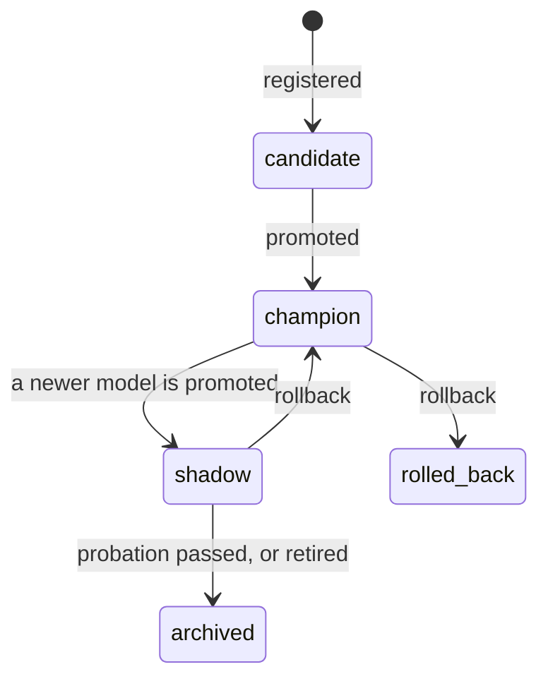

# Retraining: deciding, gating, probation and rollback

Retraining is not free and not always right. Retraining on faulty sensor data teaches the model
the fault, and retraining on every seasonal wobble burns compute and risks deploying a worse
model. The pipeline therefore splits the problem into four questions:

| Question | Answered by |
| --- | --- |
| **When** should we retrain? | the decision policy, `policy.py` |
| **On which data?** | challenger data strategies, `retrain.py` |
| **Is the new model good enough to go live?** | the promotion gate, `retrain.py` |
| **Does it stay live?** | probation and rollback, `pipeline.py` and `registry.py` |

The signals the policy reads (data quality, drift, accuracy, CUSUM) are described in
[MONITORING.md](MONITORING.md). Defaults below come from `RetrainConfig` in
`src/aqi_pipeline/config.py`.

## 1. The decision policy (`policy.py`)

Every cycle ends in exactly one action, and every decision carries a human-readable reason, so
the event log reads as an audit trail.

| Action | Meaning |
| --- | --- |
| `none` | healthy, nothing to do |
| `watch` | something moved, but it is not yet persistent, corroborated or allowed; keep monitoring |
| `hold` | recent data is unreliable; do not retrain until it is clean |
| `retrain` | train challengers now |

The rules are checked in order and the first one that applies wins:

| # | Rule | Decision | Trigger |
| --- | --- | --- | --- |
| 1 | 15 % or more of the last 3 days of PM2.5/PM10 readings are missing or faulty | `hold` | |
| 2 | A newly promoted model is still on probation | `watch` if a signal is raised, else `none` | |
| 3 | The last attempt was less than the cooldown ago | `watch` if a signal is raised, else `none` | |
| 4 | Less than 2 days of new labelled data since training | `watch` if a signal is raised, else `none` | |
| 5 | Accuracy `critical` for 2 or more cycles | `retrain` (urgent) | `performance` |
| 6 | Accuracy `warn` or `critical` for 2 or more cycles **and** drift at `warn` or `alert` | `retrain` | `performance+drift` |
| 7 | CUSUM alarm | `retrain` | `slow_decay` |
| 8 | Drift at `alert` for 5 or more consecutive cycles | `retrain` | `drift` |
| 9 | The champion is 60 or more days old and nothing was attempted for 60 days | `retrain` | `scheduled` |
| – | None of the above | `watch` if a signal is raised, else `none` | |

"A signal is raised" means accuracy at `warn` or `critical`, drift at `warn` or `alert`, or a
CUSUM alarm.

Design points:

- **Drift alone is weak evidence.** Accuracy problems must persist for 2 cycles
  (`perf_persist_cycles`); drift without an accuracy problem must persist for 5
  (`drift_persist_cycles`).
- **Cooldown with back-off.** Attempts are at least 5 days apart (`cooldown_days`). Each rejected
  attempt or rollback doubles a back-off multiplier, up to 4× (`max_backoff`), so the cooldown
  can grow to 20 days; a promotion resets it. When accuracy has collapsed (rule 5), only the
  base 5 days apply.
- **The scheduled refresh is a backstop**, not the main mechanism.

These rules are pinned by a 14-case decision-table test (`test_policy_decision_table` in
`tests/test_core.py`).

## 2. Challengers on three data strategies (`retrain.py`)

When the policy says `retrain`, the pipeline does not simply refit and deploy. It splits the data
by time:

- **holdout**: the most recent 10 days (`eval_days`), or 5 days when the retrain is urgent
  (`urgent_eval_days`), so that more of the new data can be learned from;
- **training data**: rows whose labels were already known when the holdout began (a 24-hour
  gap), so nothing from the holdout leaks into training.

If the holdout has fewer than 72 clean labelled hours, the attempt is abandoned and counts as
rejected.

The challengers are every candidate model family trained on every data strategy:

| Strategy | Training rows | Best when |
| --- | --- | --- |
| `full_history` | every clean row | the world has not changed |
| `recent_window` | only the last 150 days (`recent_window_days`) | after an abrupt change |
| `recency_weighted` | every row, weighted 0.5^(age / 45 days), minimum weight 0.02 (`half_life_days`) | a middle path |

The default model families (`model.candidates`) are `ridge` (median imputation, scaling and ridge
regression: a linear baseline) and `hgb` (scikit-learn's `HistGradientBoostingRegressor`). A
random forest (`rf`) is implemented but not enabled by default. With the defaults that makes
2 × 3 = 6 challengers. After a rejected attempt or an automatic rollback, the next attempt also
tries 4 random hyper-parameter settings for `hgb` on its best strategy (`tune_on_failure`,
`tune_iterations`).

## 3. The promotion gate

The current champion and every challenger forecast the same holdout hours. The challenger with
the lowest MAE is promoted only if **both** conditions hold:

1. it cuts holdout MAE by at least **5 %** (`min_improvement`), and
2. a **paired block bootstrap** gives at least **95 %** probability that it is better
   (`confidence`; 500 resamples, `bootstrap_samples`).

The bootstrap resamples whole days rather than hours. Hourly errors are strongly
autocorrelated, and treating hours as independent samples would overstate the confidence.

**If the gate passes**, the winner is refitted on all data up to now (so it also learns from the
holdout days), registered with a fresh drift reference and calibrated drift thresholds, and
promoted. Its expected edge over persistence (`ref_rel_mae`) is tempered: a model chosen on a
short holdout looks better than it is, so the expectation may improve on its predecessor's by at
most 20 % until probation has measured it live, and it always stays between 0.3 and 1.0.

**If the gate fails**, the champion stays, the back-off doubles and the next attempt adds
hyper-parameter tuning. The event log records the measured improvement and probability next to
the thresholds they were held to.

## 4. Probation and rollback

On promotion, the previous champion becomes the **shadow**. It keeps forecasting alongside the
new champion for 7 days (`probation_days`). Then the two are compared on the forecasts that both
made from clean inputs with clean labels (at least 48 in common):

- new champion's MAE > shadow's MAE × 1.05 (`rollback_tolerance`) → **automatic rollback**: the
  shadow becomes champion again, the failed model is marked `rolled_back`, the back-off doubles
  and the next attempt tunes hyper-parameters;
- otherwise → **probation passed**: the shadow is archived, and the champion's expected edge
  (`ref_rel_mae`) is recalibrated as the average of its expectation and its measured live ratio
  to persistence.

If there are still fewer than 48 comparable forecasts after 14 days, the shadow is retired
without a verdict. While a model is on probation the policy does not start another retrain
(rule 2), so a rollback is always one pointer swap away.

**Manual rollback:** `aqi-pipeline rollback --reason "..."` restores the shadow and resets the
CUSUM, the accuracy streak and safe mode, so the failed model's errors do not count against the
restored one. It is only possible while a shadow exists, that is, during probation.

## 5. The model registry (`registry.py`)

```
registry/
  index.json             stage pointers, version summaries, promotion history
  v001/model.joblib      the fitted ForecastModel
  v001/meta.json         how it was trained and validated, input importance, drift thresholds
  v001/reference.joblib  training-period inputs: the reference for drift checks
```



Index and metadata files are written atomically (a temporary file, then `os.replace`), so the API
never reads a half-written file while the scheduler is updating it.

## 6. What happened in the simulated year

From `sample_run/summary.json` (seed 7; production from 1 September 2025 to 31 August 2026,
one cycle per day):

- 365 cycles: 244 `none`, 102 `watch`, 7 `hold`, 12 `retrain`.
- 12 retraining attempts: 6 promoted, 6 rejected; 1 of the 6 promotions was rolled back.
- The September sensor fault produced all 7 `hold` decisions and no retraining.

| Version | Model / data strategy | Promoted | Trigger | Holdout gate (MAE: champion → challenger) | Probation (live MAE: new vs previous) |
| --- | --- | --- | --- | --- | --- |
| v001 | ridge / full_history | 31 Aug 2025 | initial model | – | – |
| v002 | hgb / recency_weighted | 15 Oct 2025 | performance+drift (start of the smoke season) | 60.4 → 44.6 (−26 %), P = 0.95 | passed: 35.9 vs 142.3 |
| v003 | hgb / recency_weighted, tuned | 9 Nov 2025 | performance | 57.5 → 13.6 (−76 %), P = 1.00 | passed: 62.0 vs 77.3 |
| v004 | hgb / full_history, tuned | 22 Feb 2026 | performance | 15.4 → 11.8 (−24 %), P = 0.99 | passed: 16.2 vs 17.9 |
| v005 | hgb / recency_weighted | 28 May 2026 | slow_decay | 14.1 → 11.3 (−20 %), P = 1.00 | passed: 22.3 vs 22.1 (within the 5 % tolerance) |
| v006 | hgb / full_history | 17 Jun 2026 | performance | 21.9 → 15.3 (−30 %), P = 1.00 | passed: 18.4 vs 20.4; champion at the end of the run |
| v007 | hgb / recency_weighted, tuned | 3 Aug 2026 | performance | 19.7 → 9.1 (−54 %), P = 1.00 | **rolled back** on 10 Aug: 11.3 vs 9.3 |

v007 is the case probation exists for: it beat the champion by 54 % on a short holdout, then did
worse live and was rolled back automatically a week later.
